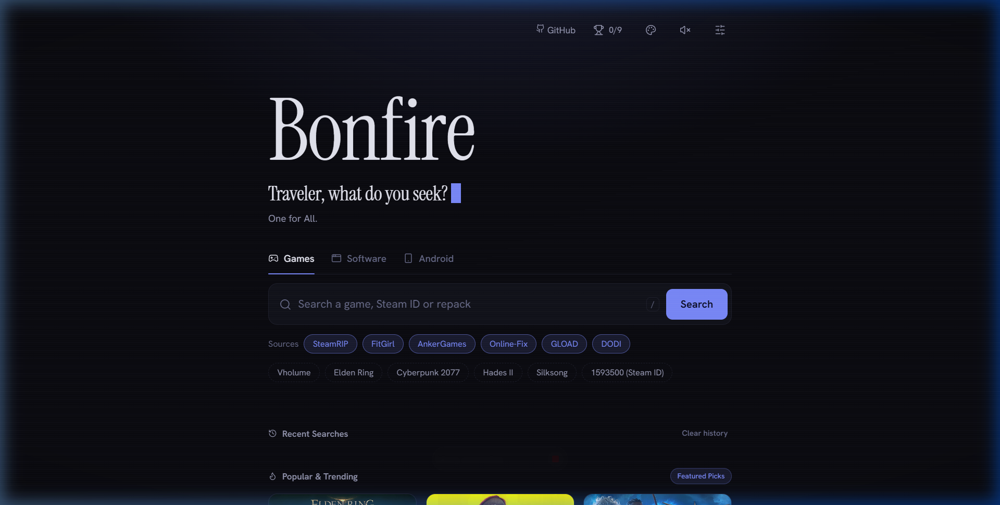
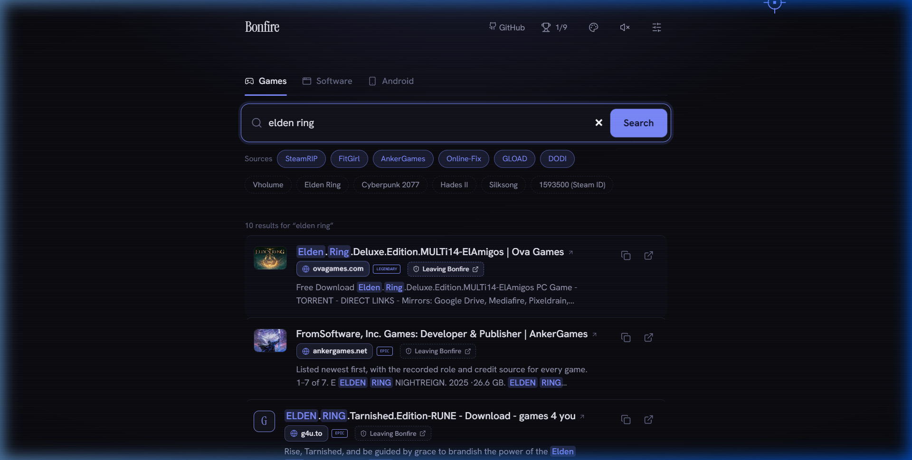
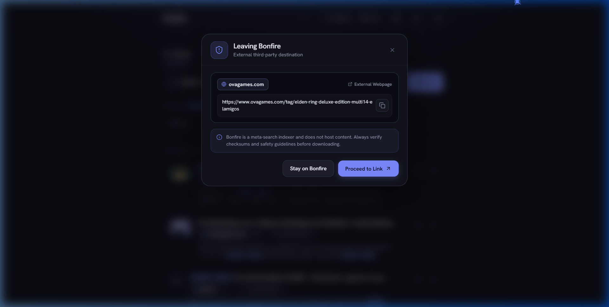
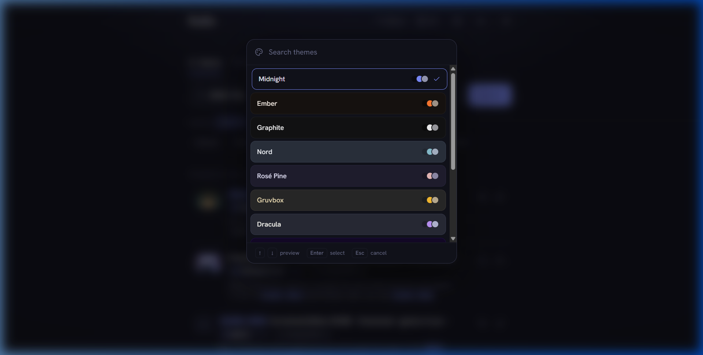

# Bonfire 🔥

A fast, no-nonsense dark mode meta-search engine for games, software, and Android APKs. No backend, no accounts, no telemetry, and zero sponsored garbage.

Most search engines these days feel like scrolling through a billboard during a sandstorm. Bonfire cuts that out by querying curated Google Programmable Search Engines across trusted repositories, then styling everything in Apple liquid glass with sound effects you will probably mute after five minutes.

Built by [Parth Sadaria](https://github.com/Parthsadaria).

---

## Screenshots

### Discovery Home
The landing screen gives you trending picks pulled with Steam cover art, recent query history stored locally in your browser, and category switchers.



---

### Search Results & Direct Domains
Search results highlight your keywords, deduplicate mirrors, and display clean source badges so you know what site you are actually looking at.



---

### Leaving Bonfire Safety Modal
Google CSE normally wraps every destination link in an internal redirect tracking URL. Bonfire strips that tracking junk out, unpacks the real destination, and presents a confirmation modal showing the raw target link with a copy button.



---

### Theme Selector
12 tailored color schemes including Midnight, Ember, Rosé Pine, Nord, Gruvbox, and Dracula. Arrow keys preview colors live before you commit.



---

## Features That Actually Matter

- **Zero server footprint**: Static HTML, vanilla CSS, and vanilla ES6+. Host it on GitHub Pages, Cloudflare Pages, or double-click `index.html` off a USB stick.
- **Google redirect unwrapper**: Unpacks `https://www.google.com/url?q=...` redirects on the client so you see real domains like `steamrip.com` or `ankergames.net` instead of Google's tracking payload.
- **Tactical reticle with context tags**: A custom SVG dual-ring crosshair that locks onto clickable elements and shows you what clicking will actually do (`VISIT`, `SEARCH`, `COPY`). You can switch back to the normal OS pointer in Settings if you hate it.
- **Vim-style keyboard navigation**:
  - `/` focuses the search bar
  - `j` / `k` navigates through result cards
  - `Enter` opens the focused card's destination dialog
  - `c` copies the destination URL
  - `t` opens the theme picker
  - `s` opens the settings panel
  - `Esc` cancels anything open
- **Query caching & deduplication**: Normalizes URLs and drops duplicate mirrors across result pages.
- **Discovery Hub**: Remembers your recent searches locally in `localStorage` and loads featured Steam games with cover art.
- **Audio synthesizer**: Generates retro UI blips with the Web Audio API without downloading audio assets.
- **Settings panel**: Lets you toggle particle sparks, sound effects, crosshair reticle, and animations independently.

---

## Quick Start

You don't need `npm install`, a build step, or 500 MB of `node_modules`.

### 1. Run directly
Open `index.html` in your browser. That's literally it.

### 2. Or serve locally with Python
```bash
python -m http.server 8000
```
Then visit `http://localhost:8000`.

### 3. Or serve with Node
```bash
npx serve .
```

---

## Customizing Search Engines

The category sources, engine tokens, and sites live in `js/config.js`. If you want to add your own CSE engine or swap sources:

1. Open `js/config.js`.
2. Find `CONFIG.categories` (`games`, `software`, `android`).
3. Swap the `cx`, `sites`, or add new categories.

---

## Tech Stack

- **Markup & Structure**: Semantic HTML5
- **Styling**: Vanilla CSS with custom properties and CSS `color-mix()`
- **Motion**: GSAP 3.12.5 + Flip plugin
- **Icons**: Lucide Icons
- **Audio**: Web Audio API oscillator synthesis
- **Fonts**: Inter / Hanken Grotesk + Instrument Serif

---

## License

MIT. Take it, hack it, host it.
